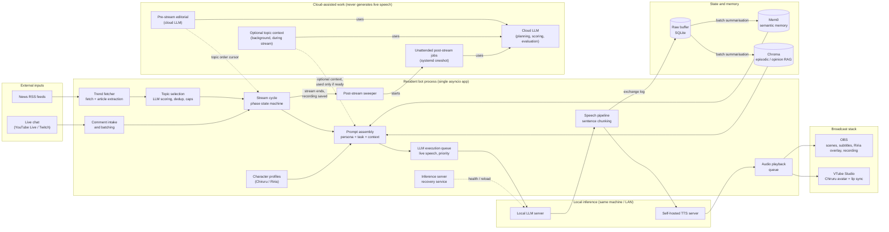

# Chiruru AI — Architecture

This repository describes the technical architecture of **Chiruru (ちるる)**, an AI VTuber that runs a daily, unscripted live show about AI and technology news. It is a portfolio of architecture notes and design lessons. **It does not contain the implementation.** The production code lives in a separate private repository.

> Status: v1 (November 2026). The production-path claims were checked against the implementation and configuration at that time. Anything that could not be verified is left out or marked as such. Experimental, shadow, and retired components are left out unless a section says otherwise.

## See Chiruru in Action

Chiruru is a continuously operating AI VTuber project, not just an architecture prototype.

- **YouTube:** [Watch live streams and recordings](https://www.youtube.com/@chiruruai)
- **Twitch:** [Visit the channel](https://www.twitch.tv/chiruruai)

## What is Chiruru?

Chiruru is an AI VTuber project: a live show run entirely by AI characters.

- **Format.** A daily live stream in Japanese. Chiruru picks up current AI and tech news, gives a short take, then digs into one story with an opinion of Chiruru's own. Between segments, viewer chat is read and answered.
- **Two characters, one model.** **Chiruru** is the main host. **Riria** is a second character who responds to Chiruru's lines, asks the questions in the Q&A corner, and takes viewer comments routed to Riria. Both are served by the same local LLM, and each has its own persona definition, voice, and avatar output.
- **Local speech generation.** Everything said in the live stream is generated in real time by a **local LLM** and a **self-hosted TTS model** on the operator's own hardware. Cloud LLMs are used mainly before and after the stream, for planning and analysis. During a broadcast they may provide optional context, but they never generate live speech.
- **Remembers.** The system keeps memory of past broadcasts, earlier opinions, and returning viewers, and feeds that context back into what is said next.
- **Light operator load.** A human starts the bot and the stream. Scheduling, the show flow, and most post-stream publishing work run on their own.

## System Overview

A single long-running Python process (asyncio) owns the live show. It has six main parts.

1. **Content intake.** It fetches news from RSS feeds and extracts the article text. A local LLM scores each item for importance, and candidates are deduplicated and balanced across categories.
2. **Show control.** A deterministic **phase state machine** decides what happens next. The phases are a news intro, a quick take, a deep dive, interactive chat, and several monologue and talk segments.
3. **Generation.** Prompts combine persona, task, and retrieved context. Live speech generation is serialized through **one priority-ordered queue** to a locally hosted LLM server. Some background and supporting operations use separate inference paths.
4. **Speech and broadcast.** Streamed LLM output is split into sentences and synthesized by a self-hosted TTS server. Each character has a separate voice. The audio is played into OBS, drives Chiruru's lip sync in VTube Studio, and triggers subtitles when playback starts.
5. **Memory.** Every exchange goes into a SQLite raw buffer. A batch process summarises it into **Mem0** (semantic and viewer memory) and **Chroma** (episodic and opinion retrieval).
6. **Offline work.** Before the stream, a cloud LLM proposes the show's topic order. After the stream, systemd jobs handle description, thumbnail, Shorts, highlights, and analytics. They track progress in receipts so they can be retried safely. Some of them use a cloud LLM for scoring and analysis.

## Architecture Diagram

The source file is [diagrams/system-overview.mmd](diagrams/system-overview.mmd).

## Key Engineering Challenges

- **Real-time speech on a local model.** Latency and stalls are what viewers notice, and one GPU-backed server is shared by live speech and background work. Live speech generation is serialized through a priority queue with explicit timeouts, plus a service that detects inference-server stalls and reloads the model. Reloads have rate limits.
- **Keeping the show alive when a component fails.** One failed utterance or a failed observation write should never stop the broadcast. Speech playback, logging, and shadow measurements are fail-open. Actions that publish or change external services are fail-closed.
- **Streaming audio without freezing the event loop.** Opening and closing the audio device can block in native code. Those calls run on a dedicated thread pool with time limits on close. Subtitles appear when audio actually starts playing, not when text is generated.
- **Unattended post-stream processing.** Recording, rendering, uploads, and analytics each fail in their own ways. Every action records its progress in a receipt and has a bounded retry budget.
- **Two characters on one model.** Two characters must stay distinct without a second model. Each has a profile that selects its persona and context features. Character-specific context is isolated where supported, while some memory components remain shared. Riria's output is validated before it is spoken.
- **Making changes measurable.** LLM behaviour drifts in ways that are easy to fool yourself about. Prompt changes are classified before they ship, A/B tests are reserved for quality claims, and offline experiment harnesses are required to match production rendering. See [Design Decisions](docs/design-decisions.md).

## Design Principles

1. **Local LLMs generate the final spoken output.** Cloud services may provide optional context during a broadcast, but they do not generate live speech, and the show does not wait for them.
2. **One owner per responsibility.** Live speech generation has one gateway (the queue). The system prompt has one composer. Post-stream work has one orchestrator.
3. **Fail-open for observation, fail-closed for side effects.** Logging and shadow measurement never block the show. Uploads and external changes stop when their preconditions are uncertain.
4. **Deterministic control, generative content.** The LLM writes what the characters say. Plain code decides what segment comes next.
5. **Idempotent automation.** Scheduled jobs and post-stream actions can be re-run safely.
6. **Models are configuration.** The current local model, TTS voice, and cloud provider are deployment choices behind narrow interfaces, not part of the architecture.
7. **Evidence before rollout.** Production-shaped offline harnesses, recorded decisions, and negative results are kept as first-class artifacts.

## Technology Stack

| Area | Technology |
|---|---|
| Runtime | Python, asyncio, systemd (services and timers) |
| Local LLM | Instruction-tuned open-weight model on a local inference server (currently LM Studio), called through a chat-completions HTTP API |
| Cloud LLM (never generates speech) | Hosted LLM for pre-stream planning, optional in-broadcast context, post-stream analysis, and offline evaluation |
| Speech | Self-hosted neural TTS behind a pluggable backend interface, streamed over HTTP |
| Avatar and broadcast | VTube Studio and OBS, both controlled through their WebSocket APIs |
| Platforms | YouTube Live (broadcast and chat), Twitch chat, Discord |
| News intake | RSS, article text extraction with a headless-browser fallback |
| Memory and retrieval | Mem0, Chroma, sentence embeddings, SQLite |

## Documentation

- [docs/architecture.md](docs/architecture.md): runtime architecture, component responsibilities, data and control flow, local vs cloud boundary, state, failure handling, and observability.
- [docs/design-decisions.md](docs/design-decisions.md): six design decisions, each with the problem, the alternatives, and the trade-offs.
- [diagrams/system-overview.mmd](diagrams/system-overview.mmd): Mermaid source for the overview diagram.
- [docs/engineering-workflow.md](docs/engineering-workflow.md): how the system is developed. It covers how the human owner and AI assistants divide judgment and authority, and how changes to an uncertain LLM system are decided from evidence. Mermaid sources: [engineering-collaboration.mmd](diagrams/engineering-collaboration.mmd), [evidence-driven-loop.mmd](diagrams/evidence-driven-loop.mmd).

## Limitations

- **This is not the source code.** Internal settings and operating parameters are intentionally omitted.
- **Single-operator system.** Chiruru is built for one machine and one channel. Nothing here is designed for multi-tenant or horizontally scaled deployment.
- **The local model sets the ceiling.** Speech quality and instruction following are limited by whichever local model is deployed. Structured output reliability depends on the deployed model and the validation pipeline.
- **Configuration-gated segments.** Several show segments and features are switched on or off by configuration. This document describes only the paths that were confirmed active. Experimental and shadow components exist but are not covered.
- **Character separation is partial.** Character-specific context is isolated where supported, while some memory components remain shared. Character consistency is enforced by rule-based checks, not by a measured live metric.
- **Model changes are not free.** Model choice lives in configuration and TTS sits behind a backend interface, but this document does not claim that any particular alternative model works without changes. Prompts are tuned to the deployed model.
- **Not covered in v1.** Inference-server settings, memory backend deployment details, and audience split across platforms.
- **No performance claims.** This document does not claim latency figures, audience growth, or quality improvements.
