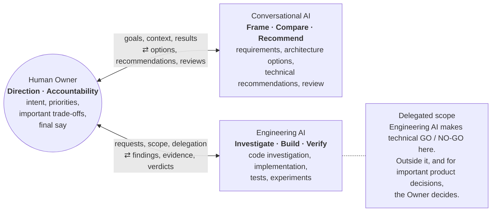
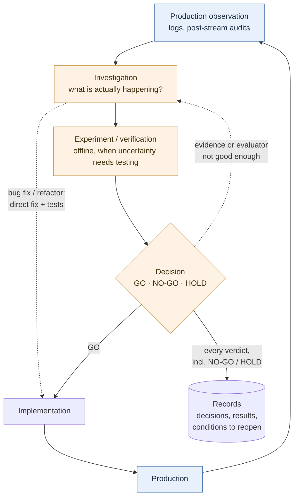

# Engineering Workflow

This document explains how Chiruru is developed. It focuses on how the owner and AI assistants share the work, and how decisions about an uncertain LLM system are made from evidence. It is not a complete process manual. [Architecture](architecture.md) and [Design Decisions](design-decisions.md) describe what the system is and why it is built that way. This document covers how changes to it are judged.

> Status: v1 (November 2026). It describes the workflow as practised at that time. Internal prompts, thresholds, records, and operating data are intentionally omitted.

## Contents

1. [Human–AI Collaboration](#1-humanai-collaboration)
2. [Evidence-driven Improvement](#2-evidence-driven-improvement)
3. [Engineering Principles](#3-engineering-principles)
4. [Lessons and Limitations](#4-lessons-and-limitations)

---

## 1. Human–AI Collaboration

**The human owns direction and accountability. AI assists with design reasoning, engineering decisions, implementation, and verification.**

| Actor | Responsibility |
|---|---|
| Human Owner | Intent, priorities, important trade-offs, final accountability |
| Conversational AI | Requirement framing, architectural reasoning, technical recommendations, review |
| Engineering AI | Code investigation, implementation, testing, experimentation, delegated technical decisions |

The diagram shows roles and how information moves between them. It is not a fixed sequence of steps. Work can start with the owner, with an idea discussed with the Conversational AI, or with a production observation. Many engineering tasks are finished and reported without going through the Conversational AI.

**Taking part in a decision is not the same as having the authority to make it.**

- **Both AIs take part in technical judgment.** The Conversational AI compares designs and makes technical recommendations, not only product suggestions.
- **The Engineering AI decides technical GO / NO-GO within delegated scope.** Examples are adopting an implementation, an experiment verdict, or a rollback.
- **The Owner decides important product questions and anything outside delegated scope.** The Owner remains accountable for whether AI proposals are adopted.
- **An AI recommendation is not human approval.** Records keep AI judgments separate from explicit owner decisions.
- **The two AIs do not share state.** When findings need to move from one to the other, the owner passes them on.

## 2. Evidence-driven Improvement

**Observe behavior, investigate uncertainty, test when necessary, and make decisions from evidence.**

- **Not every change goes around the whole loop.** Incident fixes and refactors usually skip experiments. Experiments are kept for questions where the answer is genuinely uncertain, such as whether one version of speech behavior is better than another.
- **Observation is automated, judgment is not.** In the diagram, blue nodes run on their own. Orange nodes involve the owner and the AI assistants. Nothing in the loop adopts a change automatically. This is not a self-running improvement cycle.
- **A decision can send the work back.** If the evidence is thin, or the evaluation method is in doubt, the next step is more investigation, not a rollout.
- **Negative results are kept.** NO-GO and HOLD verdicts are recorded with their reasons and the conditions under which the question may be reopened. A rejected idea should not quietly come back. A held idea should be easy to revisit when the conditions really change.

## 3. Engineering Principles

### A. Validate the evaluator

A broken evaluation is worse than none, because it produces confident wrong decisions. Before a result is trusted, the setup that produced it is examined.

- **Check parity with production.** An offline harness must give the model the same inputs that production would actually give it. It must not give the model more.
- **Check that the metric measures the intended quality.** For example, a "more varied" score can rise while the output drifts in an unwanted direction. Metrics need a direction that is defined in advance.
- **An invalid evaluator gives no verdict.** If the evaluator cannot be trusted on real outputs, its results are not used to judge quality. The evaluator itself is recorded as the failed part.

### B. Decisions survive AI sessions

AI assistants do not remember earlier sessions, so decisions have to be written down.

- Design decisions, experiment results, and NO-GO verdicts are recorded. Each record keeps the reasoning, the rejected alternatives, and the conditions under which it should be reconsidered.
- Decision records, held in an internal tool called Decision Hub, are looked up by file and topic before related work starts. Later decisions refer to earlier ones explicitly when they narrow or replace them.
- Having a record does not guarantee that it gets read. Looking up past decisions is part of the workflow, but nothing enforces it mechanically.

### C. Verification follows the type of change

| Change type | Verification |
|---|---|
| Bug fix | Reproduce the problem, then add a regression test |
| Refactor | Show that behavior is unchanged, ideally with byte-identical output |
| Quality comparison | Offline evaluation against a noise floor, then a canary if needed |
| Architecture | Record the decision, then roll out in stages and verify each stage |

Not every change needs an A/B test or a heavy experiment. A/B tests are used only for quality comparisons (see [Design Decisions §5](design-decisions.md)). Other changes still need an offline check and a way to roll back.

## 4. Lessons and Limitations

### Case study: when offline success failed to predict production behavior

1. **Offline evaluation passed.** A feature that fills gaps in the show with short spoken segments passed every offline criterion.
2. **Production did not behave as expected.** After it was switched on, the live output fell short of what the offline results had predicted.
3. **The harness was more generous than production.** Investigation found that the offline setup gave the model inputs that production did not. In one case it read a cleaned-up field where production saw raw markup. In another it used material that does not yet exist at the moment the feature runs. In a third it delivered the character's persona through a channel that the production prompt did not use. This happened more than once before it was recognized as a pattern.
4. **Parity became a precondition for interpreting results.** Offline results are now read only after the inputs the model receives have been compared, component by component, with what production renders. All-green offline metrics no longer count as evidence of parity on their own.

**Lesson:** if an offline harness is *poorer* than production, the effect usually fails to reproduce, which is easy to notice. If it is *richer* than production, the results look better than reality, which is hard to notice. The problem was not prevented in advance. It was found in production, and the lesson changed how every later experiment is read.

### Limitations

- **No overall quality claim.** This workflow does not demonstrate that Chiruru's speech quality has improved overall.
- **Automation is partial.** Mostly observation, parts of implementation, and some checks are automated. Decisions involve the human owner.
- **Safeguards are not all enforced.** Looking up past decisions and many other safeguards are conventions applied with judgment, not mechanical gates.
- **AI contribution is unmeasured.** The effect of AI assistants on development speed or decision quality has not been measured.
